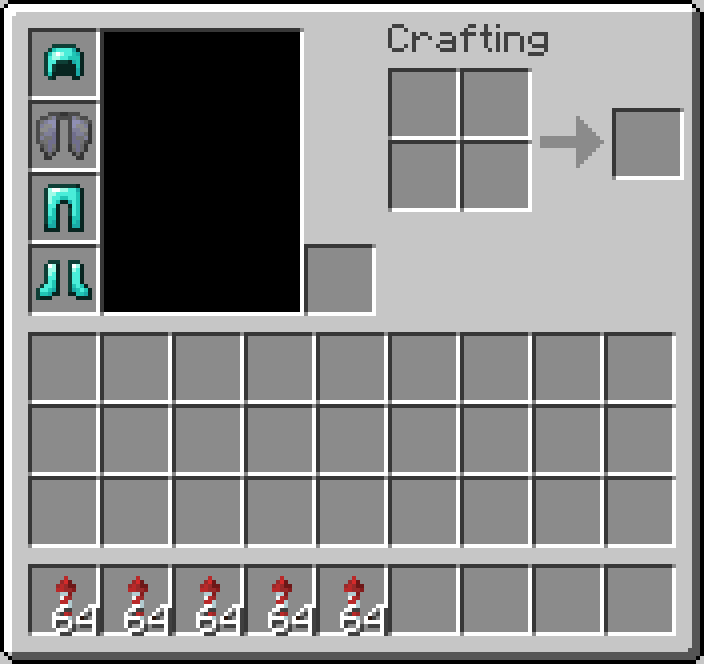

# Test Gear Distribution

**English** | [繁體中文](README.zh-TW.md)

Equips testers with temporary gear - diamond armor with an elytra, all with Curse of Binding and Curse of Vanishing - plus 320 firework rockets, and stops the gear from being dropped or stored.

> This repository has two editions of the same script: **繁體中文 (zh-TW)** is the original used on the author's Traditional Chinese server, and **English** is a full translation (commands, messages and variable names) with the same features.

<!-- BEGIN LIVE SCREENSHOTS -->

## Screenshots

*A throwaway test account right after `/發放測試裝備`: full diamond armour plus an elytra, all tagged `測試用道具`, and five stacks of firework rockets.*

> These are live-server captures, not native client screenshots. A headless client logged into a real Paper 26.2 server, triggered the script, and the block / UI data the server sent back was re-rendered using the official Minecraft 26.2 client assets. Mojang/Microsoft image assets are not covered by this repository's code licence.

<!-- END LIVE SCREENSHOTS -->

## Features

- Puts the gear straight into the armor slots (helmet, elytra, leggings, boots)
- Curse of Binding + Curse of Vanishing: can't be taken off and disappears on death
- Unbreaking III + Mending, plus 320 firework rockets
- Blocks dropping the gear or putting it into containers
- Recall from one player or everyone (fireworks are kept) and list who is wearing it

## Requirements

- [Paper](https://papermc.io/) server (developed on Paper 26.2 / Minecraft 26.2)
- [Skript](https://github.com/SkriptLang/Skript) (developed on 2.16.2)

## Installation

1. Install the plugins listed under [Requirements](#requirements).
2. Download **one** edition:

   | Edition | File(s) |
   |---|---|
   | English | [`en/test-gear-distribution.sk`](en/test-gear-distribution.sk) |
   | 繁體中文 (original) | [`zh-TW/測試裝備發放系統.sk`](zh-TW/%E6%B8%AC%E8%A9%A6%E8%A3%9D%E5%82%99%E7%99%BC%E6%94%BE%E7%B3%BB%E7%B5%B1.sk) |

3. Copy the `.sk` file(s) into `plugins/Skript/scripts/` on your server.
4. Run `/sk reload test-gear-distribution` (use the file name you copied) or restart the server.

> [!IMPORTANT]
> Install **only one** edition. Both editions are the same script in different languages - loading both makes them clash or run twice.

## Commands

| Command (English edition) | zh-TW edition | Description | Permission |
|---|---|---|---|
| `/givetestgear [player]` | `/發放測試裝備 [玩家]` | Give the gear to a player, or to everyone online when omitted | OP |
| `/recalltestgear <player>` | `/回收測試裝備 <玩家>` | Recall a player's gear | OP |
| `/recallalltestgear` | `/回收全部測試裝備` | Recall the gear from everyone online | OP |
| `/checktestgear` | `/查看測試裝備` | List the online players wearing test gear | OP |

## Configuration

- `item_name` in `options:` identifies the gear - keep it unique.

## Notes

- ⚠️ Giving the gear **replaces** whatever the player is wearing in those slots; the old armor is not returned.

## Related projects

- [skript-tester-thank-you-kit](https://github.com/Im-Tim-mI/skript-tester-thank-you-kit) - Tester Thank-You Kit
- [skript-special-item-lock](https://github.com/Im-Tim-mI/skript-special-item-lock) - Special Item Lock

## License

**MIT + Commons Clause** - see [LICENSE](LICENSE) for the full text.

- ✅ You may use, copy, modify and share this script.
- ✅ You **may** install and run it - including modified versions - on Minecraft servers that charge money or are run for profit.
- ❌ You may **not** sell the script itself or modified versions of it, directly or indirectly, or require payment to obtain its files or source code.

Copyright (c) 2026 廷廷小教室、廷廷的家（Tim945）
